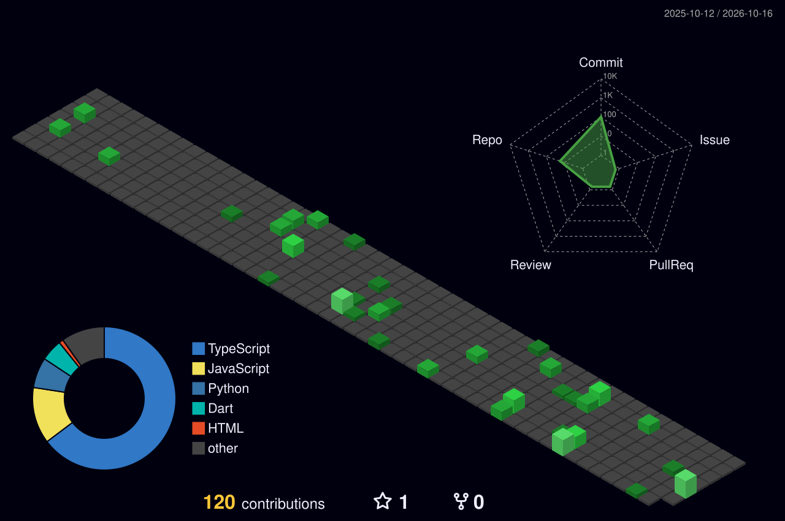

# Hey, I'm Bhargav

### AI/ML Engineer-in-the-making · Full-Stack Builder · Hackathon Competitor

*I build software that solves real problems, and I like understanding the fundamentals behind it.*

---

## About Me

I'm a **B.Tech student in Artificial Intelligence & Machine Learning at HITAM**, with hands-on experience across full-stack development, systems design, and AI integration. I've built everything from gamified sustainability trackers to encrypted cross-device sync tools, and I lead R&D for an engineering student chapter.

- **Technology Intern** at **CallHealth** (Mar – Sep 2026)
- **Lead R&D**, IUCEE EWB HITAM Student Chapter
- **Co-authored a published research paper** (ICLAMP Conference Proceedings, April 2026)
- **Multiple award wins** at project expos, ideathons, and a national science festival
- **Built websites for NGOs** as a volunteer developer

---

## Achievements

| Award | Event | For |
|---|---|---|
| **1st Prize** | Project Expo | Career Ladder |
| **3rd Prize** | Aavishkar Manthan 2026, Malnad University | Career Ladder |
| **3rd Prize** | Market Minds | EcoTracker |
| **3rd Prize** | AUNSF (Anurag University National Science Festival) | — |
| **Published** | [ICLAMP Conference Proceedings, Apr 2026](https://www.asu.edu.bh/wp-content/uploads/2026/04/ICLAMP-Proceedings-5-new-one-2-1.pdf) | Co-authored research paper |

---

## Featured Projects

### Career Ladder — *1st Prize, Project Expo · 3rd Prize, Aavishkar Manthan 2026*
An AI-powered career advancement platform that aggregates job-market data and automates resume analysis, helping students plan and streamline their job search.

### EcoTracker — *3rd Prize, Market Minds*
A Duolingo-inspired, gamified web app for tracking daily carbon footprint across **travel, energy, and diet**. Points and milestones keep users engaged in climate-friendly habits.

### WarDrop (WardropBridge)
A **Progressive Web App** for real-time clipboard sharing across devices on a local network.
- React 19 + Vite + Tailwind CSS
- **Fernet symmetric encryption** for secure text transfer
- Optional AI-driven clipboard intelligence

### IdeaForge
An educational platform that teaches people to **architect and build software projects themselves**, emphasizing active learning and engineering fundamentals over AI-generated shortcuts.

### Volunteer Web Development
Designed, built, and deployed official websites for:
- [IUCEE EWB Student Chapter](https://iucee.hitam.org/)
- [Helping Hearts NGO](https://helpingheartsfortheneedy.org/)

---

## Tech Stack

**Languages**

**Frontend & Backend**

**Cloud, Data & DevOps**

**AI & Security:** Machine Learning · AI Integration · Local AI Models · Fernet Encryption

---

## Education & Certifications

- **B.Tech, Artificial Intelligence & Machine Learning** — Hyderabad Institute of Technology and Management (HITAM)
- **Certifications:** Machine Learning · Anthropic Claude Certifications
- **Hackathons:** Bharatiya Antariksh Hackathon · WED WFEO Hackathon · Google XPrize · Google Gemini 3 Hackathon

---

## GitHub Stats

---

## Let's Connect

I'm open to internships, collaborations, and conversations about AI, full-stack development, and building things that matter.

- [LinkedIn](https://www.linkedin.com/in/bhargav-reddy-6369b732b/)
- [Bhargavreddy9t@gmail.com](mailto:Bhargavreddy9t@gmail.com)

*If something here caught your eye, feel free to explore my repos!*

## GitHub Contributions

